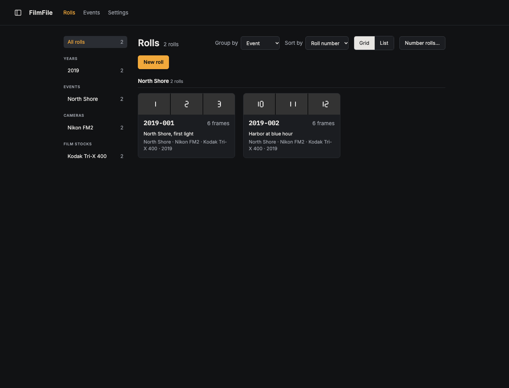
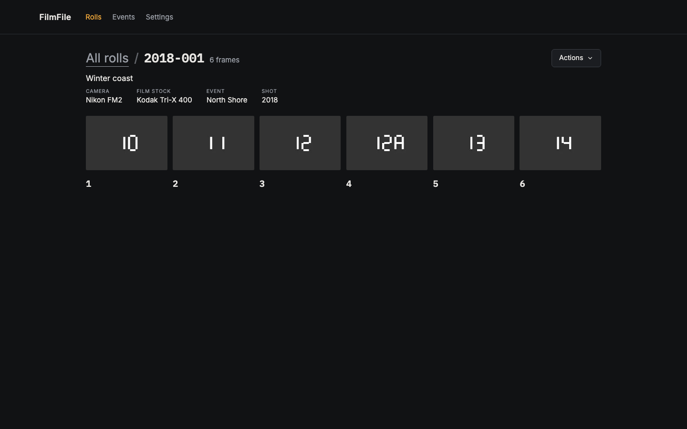

# FilmFile

A local-first catalogue for film photographs. FilmFile links each frame to its roll and frame number, organizes images by roll and event, and keeps scans and later versions together.

Status: early development. The browser and desktop apps support rolls, scans, frame numbering, version kinds, and event browsing. NegPy integration, backup and sync, workflows, and publishing are planned.

## Screenshots

These screenshots use generated lab-scan fixtures to show the current interface.





## Running it

Needs Node 26 and pnpm.

```sh
pnpm install
pnpm dev                                   # backend and UI with live reload, using .dev-folder/
mkdir -p ~/FilmFile && pnpm build && FILMFILE_FOLDER=~/FilmFile pnpm start   # the built UI, served by the backend
```

`pnpm package` builds the desktop app (`apps/desktop/out/FilmFile.app` and `FilmFile.dmg`), and `pnpm install:app` builds it and prints the `sudo` command that puts it in /Applications, replacing the one there (quit FilmFile first).

The UI is at http://localhost:5173 with `pnpm dev`, or http://127.0.0.1:4310 with `pnpm start`. API docs are at `/api/docs`. `pnpm verify` runs the checks and tests CI runs; `pnpm e2e` runs the end-to-end tests in Chromium (once: `pnpm exec playwright install chromium`).

## Architecture

- The filesystem is the source of truth. Roll, event, and equipment metadata is stored as JSON alongside original image files.
- The backend is the only archive writer. The browser UI is an API client; the Electron app starts the same backend locally.
- Originals are write-once. A new scan, raw scan, or final is a separate version; generated previews live in the cache.
- S3 backup and sync, workflows, and gallery publishing are planned, not current features.

## Docs

- [Design](docs/design.md): goals, domain model, archive layout and architecture.
- [Technical architecture](docs/technical-architecture.md): current code layers, dependency rules and request flow.
- [CLAUDE.md](CLAUDE.md): engineering conventions.
