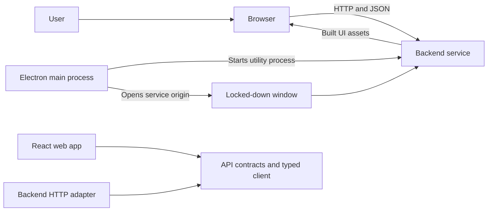
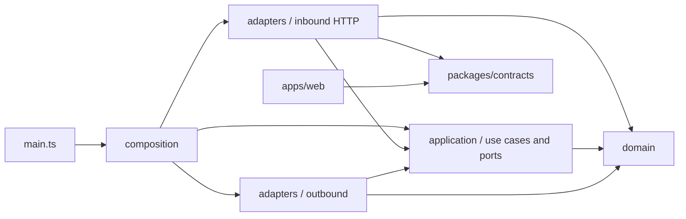
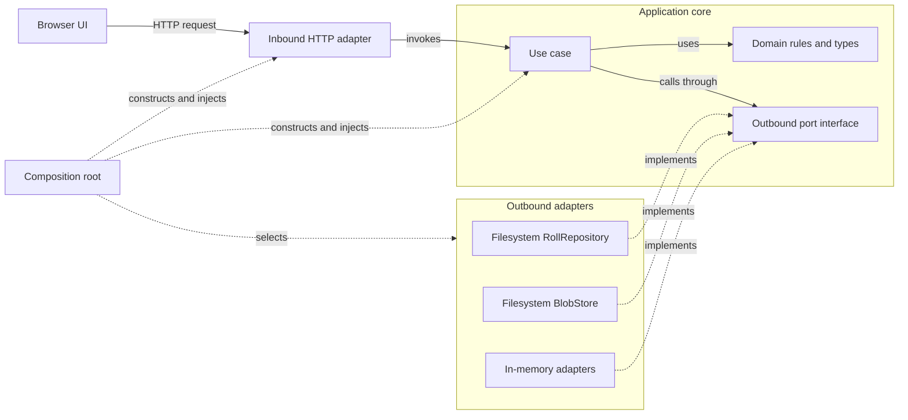
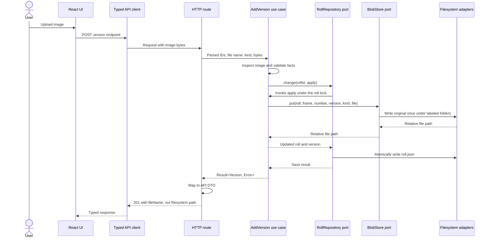

# Technical Architecture

This document describes how the code is organized today and how a request moves through it. The broader goals and future design are in [design.md](design.md); this guide distinguishes implemented code from planned architecture.

## Runtime and Packages

The backend is the only service that reads and writes the archive. The browser UI calls its HTTP API. The Electron desktop app starts that same backend in a utility process and opens a window on it. Both the backend HTTP adapter and web UI use the shared contracts package.

The important package boundaries are:

- [`apps/backend/src/main.ts`](../apps/backend/src/main.ts) reads configuration, prepares the selected FilmFile folder, composes the local service, and binds it to `127.0.0.1`.
- [`apps/web/src/main.tsx`](../apps/web/src/main.tsx) creates the React app and typed API client. The UI does not import backend code.
- [`packages/contracts/src/rolls.ts`](../packages/contracts/src/rolls.ts) and its neighboring contract modules define API request and response schemas. [`packages/contracts/src/api-types.ts`](../packages/contracts/src/api-types.ts) is generated from OpenAPI; [`packages/contracts/src/client.ts`](../packages/contracts/src/client.ts) builds the `openapi-fetch` client.
- [`apps/desktop/src/main.ts`](../apps/desktop/src/main.ts) owns the desktop lifecycle. [`apps/desktop/src/start-service.ts`](../apps/desktop/src/start-service.ts) starts the backend separately and waits for it to answer; Electron does not construct or import backend adapters.

## Backend Layers

Backend layers are folders within `apps/backend/src`. In this diagram, an arrow means “may import”; it does not mean a runtime call direction.

The boundaries have these responsibilities:

| Layer | Responsibility | Code to start from |
|---|---|---|
| `domain/` | Pure business types, parsing, rules, and expected errors. It does not perform I/O or depend on outer layers. | [`roll.ts`](../apps/backend/src/domain/rolls/roll.ts), [`frame-number.ts`](../apps/backend/src/domain/rolls/frame-number.ts), [`result.ts`](../apps/backend/src/domain/shared/result.ts) |
| `application/` | Use cases coordinate domain behavior through interfaces called ports. A use case receives its dependencies in its constructor and exposes `execute(ctx, input)`. | [`add-version.ts`](../apps/backend/src/application/use-cases/frames/add-version.ts), [`roll-repository.ts`](../apps/backend/src/application/ports/roll-repository.ts), [`blob-store.ts`](../apps/backend/src/application/ports/blob-store.ts) |
| `adapters/inbound/` | HTTP routes validate requests, call use cases, map results to HTTP responses, and translate domain entities into API DTOs. Middleware applies request guards, headers, and error handling. | [`create-app.ts`](../apps/backend/src/adapters/inbound/http/create-app.ts), [`routes/rolls.ts`](../apps/backend/src/adapters/inbound/http/routes/rolls.ts), [`roll-dto.ts`](../apps/backend/src/adapters/inbound/http/routes/roll-dto.ts) |
| `adapters/outbound/` | Implement ports using filesystem, memory, Node, or image libraries. Persistence schemas and filesystem safety helpers live beside the filesystem adapters. | [`filesystem-roll-repository.ts`](../apps/backend/src/adapters/outbound/filesystem/filesystem-roll-repository.ts), [`filesystem-blob-store.ts`](../apps/backend/src/adapters/outbound/filesystem/filesystem-blob-store.ts), [`roll-file.ts`](../apps/backend/src/adapters/outbound/filesystem/roll-file.ts), [`safe-path.ts`](../apps/backend/src/adapters/outbound/filesystem/safe-path.ts) |
| `composition/` | Construct adapters, inject them into use cases, and provide those use cases to the HTTP adapter. This is the only place that chooses concrete implementations. | [`compose-local.ts`](../apps/backend/src/composition/compose-local.ts), [`compose-in-memory.ts`](../apps/backend/src/composition/compose-in-memory.ts), [`use-cases-for.ts`](../apps/backend/src/composition/use-cases-for.ts) |

## Hexagonal Architecture: Ports And Adapters

Hexagonal architecture separates the application policy from the mechanisms that deliver requests and perform I/O. “Hexagonal” describes the boundary, not a required number of modules: the core can have multiple inbound and outbound adapters without changing its rules.

- **Inside the boundary:** the domain owns business concepts and rules. Application use cases coordinate those rules and define ports for capabilities they need. The ports belong to the application, which is the caller and therefore sets the interface it needs.
- **Driving adapters:** initiate a use case. Today the HTTP routes are the driving adapter: they parse and validate requests, call a use case, and map its result to a response. The web app is an API client, not an adapter inside the backend.
- **Driven adapters:** satisfy ports called by a use case. The filesystem `RollRepository` and `BlobStore` are examples. In-memory implementations satisfy the same ports in tests.
- **Composition:** constructs one implementation of each port and injects it into the use cases. A use case names an interface, not a filesystem class; the same use case can run with memory-backed or filesystem-backed storage.

The relationships below distinguish runtime calls from implementation and wiring. Solid arrows are calls. Dashed arrows mean “implements this port”. Dotted arrows show composition-time construction and injection.

For example, [`AddVersion`](../apps/backend/src/application/use-cases/frames/add-version.ts) depends on the `RollRepository`, `BlobStore`, `ImageInspector`, `IdGenerator`, and `Clock` interfaces. It asks the roll repository to apply and save a change; while that change is being applied, it asks the blob store to write the original image. [`compose-local.ts`](../apps/backend/src/composition/compose-local.ts) supplies filesystem storage, sharp inspection/previews, and Node clock/ULID adapters. [`compose-in-memory.ts`](../apps/backend/src/composition/compose-in-memory.ts) supplies memory storage and deterministic clock/ID adapters for tests.

This is the dependency inversion at the heart of the design: application code owns the port definitions, while infrastructure depends inward on those definitions. Replacing local files with another adapter is therefore a composition change, provided the new adapter honors the same port contract. HTTP DTOs and persisted JSON remain separate representations, mapped at their respective boundaries.

[`eslint.config.ts`](../eslint.config.ts) encodes the import boundaries with `eslint-plugin-boundaries`; architecture tests exercise those rules against fixtures. The domain can therefore stay independent of storage and HTTP, while an adapter can be replaced without changing a use case.

## A Request Through The Layers

This sequence follows uploading an image as a version of a frame:

The route definition and handler are in [`routes/rolls.ts`](../apps/backend/src/adapters/inbound/http/routes/rolls.ts). [`AddVersion`](../apps/backend/src/application/use-cases/frames/add-version.ts) depends on the `RollRepository`, `BlobStore`, `ImageInspector`, `IdGenerator`, and `Clock` ports. In the local composition, those ports resolve to filesystem and Node adapters plus the sharp-based image inspector. The filesystem repository serializes roll changes and writes validated JSON atomically; the blob store writes each original once. The API DTO exposes only the original basename as `fileName`, never the internal relative path.

Expected failures travel back as `Result<T, E>` values and are mapped by the HTTP adapter to status codes. Unexpected I/O errors or bugs throw and are handled by the error middleware, which returns a generic response and logs a correlation ID.

## Composition And Storage

[`compose-local.ts`](../apps/backend/src/composition/compose-local.ts) wires the production-like local runtime: filesystem settings, roll, equipment, event, blob, and holding-area adapters; Node time and ULIDs; and sharp image inspection and previews. [`compose-in-memory.ts`](../apps/backend/src/composition/compose-in-memory.ts) swaps most storage ports for memory adapters and uses a fixed clock and sequential IDs for deterministic tests.

The filesystem is the source of truth. Roll, event, equipment, and settings metadata are JSON; image bytes are stored in the archive beside their version metadata. The filesystem adapter validates persisted records when reading them and resolves paths through the safe-path helper. Preview/cache data is kept outside the archive. The current composition has no SQLite catalogue-index port or adapter; listing rolls reads through `RollRepository` directly. S3 and cloud compositions remain future design work rather than active runtime dependencies.

## Contracts And Tests

The Zod schemas in `packages/contracts` define the HTTP boundary and generate the OpenAPI description. The backend maps between these API DTOs, domain types, and filesystem persistence schemas instead of sharing one model across all three boundaries. The web app uses the generated client and imports only `@filmfile/contracts` from the workspace.

Tests match the architecture: domain rules have unit tests; use cases run with in-memory adapters; shared port contract suites run against adapters; API tests use Hono with an in-memory composition; and Playwright journeys exercise the local service against a temporary archive. For examples, see [`filesystem-roll-repository.test.ts`](../apps/backend/test/adapters/filesystem/filesystem-roll-repository.test.ts), [`roll-repository-contract.ts`](../apps/backend/test/contracts/roll-repository-contract.ts), and [`test/e2e`](../test/e2e).
